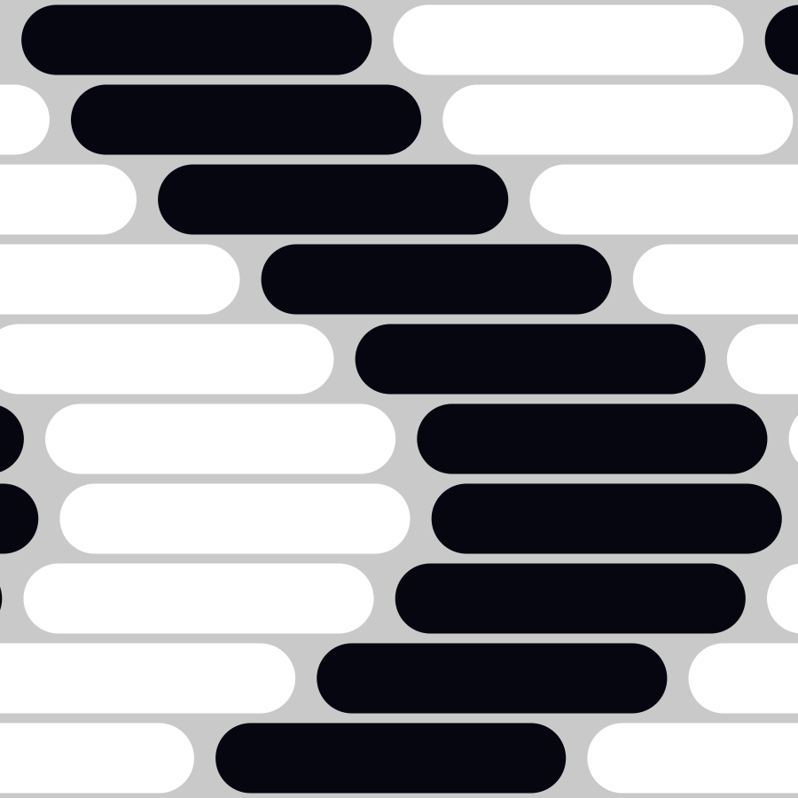
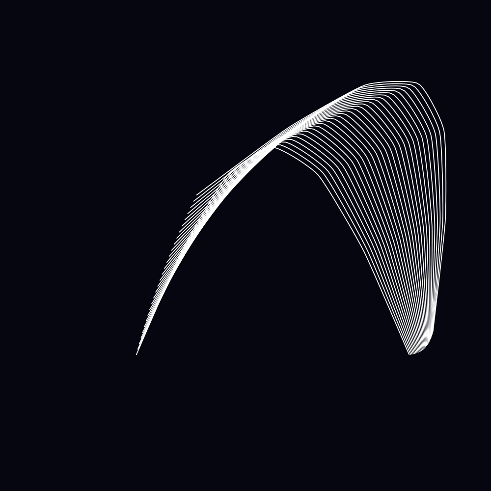
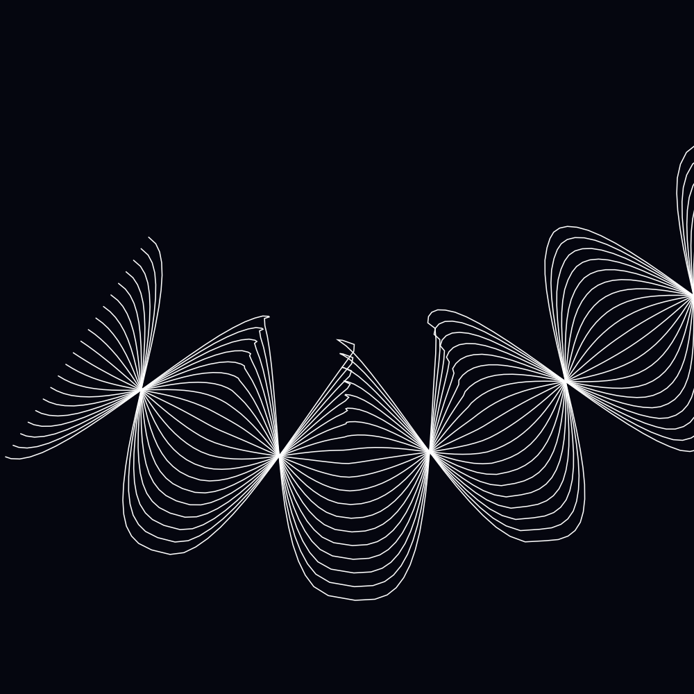

# Pill Painter — Figma plugin

A pattern maker with five engines that share one canvas, one spline editor, one
set of scrub dials, and one insert pipeline into real Figma nodes.

## Install

Local development plugins require the **Figma desktop app**.

1. Figma desktop → **Plugins → Development → Import plugin from manifest…**
2. Select `manifest.json` from this folder.
3. Run from **Plugins → Development → Pill Painter**.

No build, no dependencies, no network access.

## Modes

### PATT — pill pattern
Full-width tiled rows of alternating A/B pills, phase-shifted row by row along
an editable spline (wave presets or hand-drawn). Row drift for staircases.
Inserts as rectangles grouped per row inside a clipped frame.

### RIBBON — dimensional ribbon
Draw a path; pills stack along it as a ribbon twisting in 3D. Segments run at
full width mid-turn, pinch to dots at each flip, and swap between color A and B
(front/back). `fullness` shapes the segments, `foreshorten` narrows the ribbon
where the path runs horizontal, `FLIP BY FOLD` swaps color at direction
reversals instead of twist flips.

### LINES — blend / momentum
Draw a path; N copies blend from it toward a transform — `rotate to`,
`scale to`, `shift x/y` — plus an optional perpendicular `offset gap`
(offset-path style). The trail of intermediate strokes reads as momentum,
like the blend/offset tools in Illustrator. Inserts as vector strokes.

### TWIST — lines through z
Draw a path; a strip of longitudinal lines follows it while rotating around the
path axis. Lines converge, cross at each half-turn, and fan back out — a
twisted wireframe. `ribs every` adds cross-lines for a full mesh. Inserts as
vector strokes.

### TYPE — Dia-style repetition
Text repeated to fill every line. The gap between repeats is modulated by a
wave down the page (`gap min` → `gap max`, `wave cycles`, `wave phase`,
triangle or sine), and each row is justified to the board width — so columns of
words emerge, compress, and dissolve (the JUST-DO-IT grid). `stagger / row`
switches to a tiled offset-grid instead (the staggered poster look). Inserts as
**real Figma text nodes** grouped per line — font family is loaded with
graceful fallback (requested family → Helvetica Neue → Inter), weight mapped to
the nearest available style.

## Dials

Every numeric control is a scrub dial:
type a value / drag the label (relative) / drag the bar (absolute) / scroll.
`⇧` = fine, `⌥` = coarse. `↑↓` in a field steps, `⇧↑` ×10.

**Every dial has an animate checkbox** — checked, it ping-pongs across its
range. `ANIMATE → speed` sets the global rate; STOP ANIMATION freezes
everything. Insert mid-animation captures the current frame.

## Spline editing (PATT / RIBBON / LINES / TWIST)

- **DRAW**: drag a path; it's simplified (`simplify`) into control points.
- **EDIT** (Tab): drag points, **⌥click** the curve to insert, **double-click**
  to delete, **⇧drag** locks x to the neighbour. `tension` slackens the
  Catmull–Rom fit.

## Shortcuts

| Key       | Action                                   |
| --------- | ---------------------------------------- |
| `Tab`     | DRAW / EDIT                              |
| `⌘Z`      | Undo (80 steps)                          |
| `⌫`       | Delete selected point                    |
| `[` / `]` | Mode's main size dial −/+                |
| `⌘↵`      | Insert into Figma                        |
| `Esc`     | Close                                    |

## What gets inserted

A clipped `FRAME` at board size with the background color, then per mode:
rectangles grouped per row (PATT), one `ribbon` group (RIBBON), vector networks
with round caps/joins (LINES / TWIST), or text nodes grouped per line (TYPE).
If a frame is selected it nests inside at 0,0; otherwise it lands centered in
the viewport.

## Files

| File            | Purpose                                                  |
| --------------- | -------------------------------------------------------- |
| `manifest.json` | Plugin manifest (`ui` points at `index.html`).           |
| `code.js`       | Main thread — rectangles, vectors, text, font loading.   |
| `index.html`    | The whole maker.                                         |
| `ui.html`       | Identical copy, kept for convenience.                    |
| `example-*.png` | Reference renders of the engines.                        |

## Licence

Do whatever you want with it.
